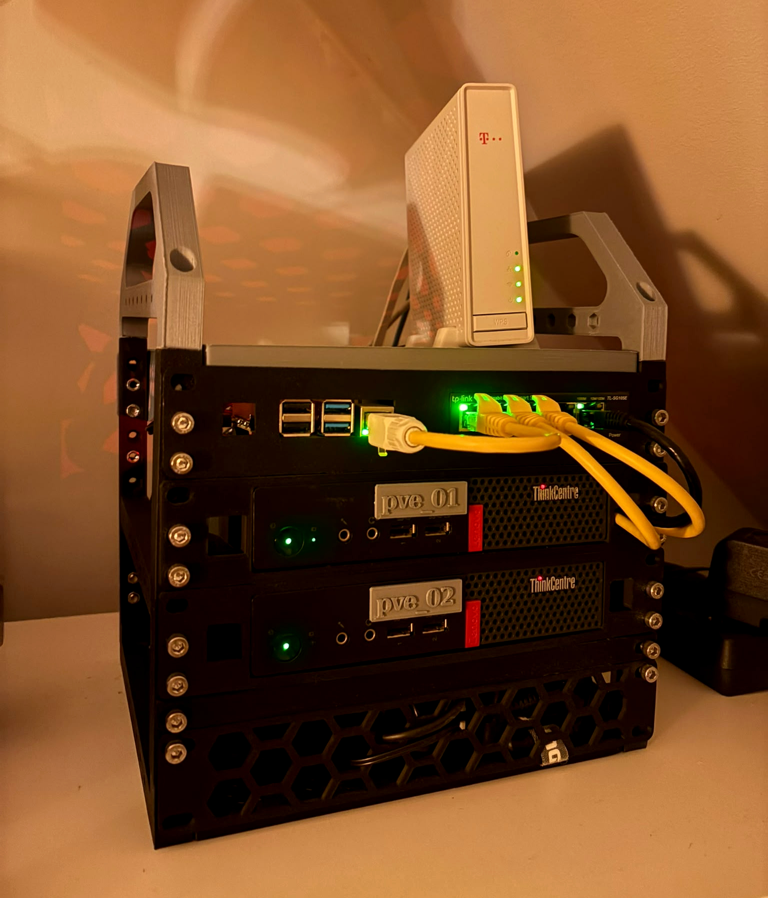

# homelab-iac

Infrastructure-as-code for my homelab -- a 2-node Proxmox cluster plus a Raspberry Pi. Provisioned and maintained with Terraform ([bpg/terraform-provider-proxmox](https://github.com/bpg/terraform-provider-proxmox) provider), Ansible, Docker Compose and CI/CD via self-hosted Gitea.

It started as a way to stop manually configuring VMs and reverse-engineering the same fixes every few months, and turned into an actual sandbox for the tools that are difficult to learn "in the vacuum" from tutorials.

Every tool here is open-source and self-hosted, by design. Anyone with some old hardware and a little patience should be able to reproduce this, especially with no paid licenses or vendor locks.

Right now, this repository is both a working system and a learning project. Everything described here is running right now, or was running and got replaced. 

---

## Contents

- [Hardware](#hardware)
- [What is automated, and what is not](#what-is-automated-and-what-is-not)
- [Networking (in progress)](#networking-in-progress)
- [CI/CD](#cicd)
- [Observability](#observability)
- [NAS](#nas)
- [Backups](#backups-in-progress)
- [Repository layout](#repository-layout)
- [Roadmap](#roadmap)

---

## Hardware



- **Rack**: A 10-inch modular server rack based on existing design created by [Mauricio Pessoa](https://www.printables.com/@Mauker) that I modified to my needs and 3d-printed myself.

- **Compute**:

  | Device | Hostname | Role | CPU | RAM | Storage |
  |--|--|--|--|--|--|
  | Lenovo M910q | pve01 | Proxmox node | i5-7500T | 32GB | 500GB SATA SSD, 250GB NVME SSD |
  | Lenovo M910q | pve02 | Proxmox node | i5-7500T | 32GB | 500GB SATA SSD |
  | Raspberry Pi 4B | homelab-rpi | Proxmox QDevice | Cortex-A72 (arm) | 8GB | 64GB SD |

  Raspberry Pi acts as a quorum device so the cluster survives a single node loss without a full 3-node setup.

- **Internet**: ISP ODU feeding an ISP IDU (vendor-locked to ODU). IDU
  currently acts as the primary router/DHCP server for the whole
  network. The connection sits behind carrier-grade NAT (CGNAT), it means no
  public IP and no inbound port-forwarding for the time being.

- **Switch**: a 5-port TP-Link SG105E managed switch (VLAN and
  port-mirroring capable).
  
  | Port | Device |
  |---|---|
  | 1 | homelab-rpi |
  | 2 | pve01 |
  | 3 | pve02 |
  | 4 | - |
  | 5 | WAN uplink |

- **NAS**: a 2TB HDD physically passed through to a NAS virtual machine via `scsi1` and `USB-SATA` adapter. This disk is **never** managed by Terraform. It's attached and moved between VMs by hand, because it's the one piece of hardware in this lab that can't be casually rebuilt if something goes wrong with it. The virtual machine responsible for handling network attached storage is IaC managed, though.

## What is automated, and what is not

Not everything is Terraform/Ansible-managed. The general policy is: **automate what benefits from repeatability, keep manual what's either foundational, irreplaceable, or impossible to automate.**

My homelab also runs small Windows Server environment (a domain controller and 2 members) that I test stuff for work with and a game server on another Linux VM.

### Terraform + Ansible managed

 | Host | Role |
 |---|---|
 | `nas` | NFS export + Samba|
 | `monitor` | Zabbix stack (server, db, gui), Uptime Kuma |
 | `mediaserver` | Jellyfin, Jellyseerr, *arr stack |
 | `torrentbox` | Gluetun (WireGuard VPN) + Transmission |
 | `jumpbox` | Tailscale Subnet Router |
 | `proxy` | Nginx Proxy Manager |
 | `tools` | Portainer (gui), Grafana, Loki, Wiki.js, DBGate |

Every one of these VMs is provisioned from a shared **golden image**, a
cloud-init-enabled Ubuntu template that Terraform clones for each VM. Cloning
from one template means every VM starts from an identical baseline.

Ansible then applies the same baseline (Docker, Zabbix agent, Portainer agent, Promtail, Diun), and VM's own service stack after.

### Ansible-only (no VMs to provision)

- **rpi**: AdGuard Home (DNS/ad-blocking), Homer (dashboard),
  the Proxmox qdevice service, plus the same baseline agents as the VMs.

### Deliberately manual

| Item | Why it's manual |
|---|---|
| `homelab-devops` | Runs everything related to repository -- Gitea, act runner and MinIO. Automating this VM seems like a chicken-and-egg problem.
| `homelab-pbs` (Proxmox Backup Server) | This is the backup system. A bit too consequential to risk at the moment. |
| `Proxmox QDevice` | Cluster quorum pairing is a one-time operation |
| `2TB NAS HDD` | Physical passthrough, moved between VMs manually via `qm set`. VM is templated, but the HDD attachment is not. |

Reference copies of the docker-compose files deployed manually live in
[`other/compose/`](./other/compose/).

<details>
<summary><strong>Why not just automate everything?</strong></summary>

Two Proxmox nodes and the Raspberry Pi's base OS were all installed manually. I did not consider scripting cluster formation and initial OS setup.

`homelab-pbs` and `homelab-devops` follow the same reasoning as the NAS disk: too consequential to risk. `homelab-pbs` is the backup system — if a bad automated change broke it, the safety net would be gone at the exact moment something else might need it. `homelab-devops` runs the tools that would be doing the automating in the first place. It's fundamental for the whole infrastructure.

Virtual machines not managed by Terraform have `homelab-` prefix in the name. IaC managed VMs don't have the prefix. For example, `homelab-rpi` and `mediaserver`.

</details>

## Networking (in progress)

I'm planning a migration from a single flat `192.168.1.0/24` to a
segmented, VLAN-based design behind a OPNsense.

| VLAN | Subnet | Purpose |
|---|---|---|
| 1 (native) | `192.168.1.0/24` | WiFi / non-lab |
| 10 | `192.168.10.0/24` | core / management |
| 20 | `192.168.20.0/24` | services |
| 30 | `192.168.30.0/24` | isolated |

## CI/CD

Self-hosted **Gitea** with **Gitea Actions** running on a
Docker-based runner (on `homelab-devops`):

- **`terraform plan`** -- runs automatically on every push touching
  `terraform/**`.
- **`terraform apply`** -- manual-trigger only (`workflow_dispatch`).
  Never runs automatically, gated behind a "Run workflow" button.
- **Terraform drift check** -- scheduled twice a day, fails the build if
  real infrastructure has diverged from what is declared in code.
- **Ansible drift check** -- same cadence, runs every playbook in
  `--check` mode against the live fleet and fails when a drift is found.
- **OS update check** -- scheduled once a day, checks every host in the
  lab for available OS package updates and reports
  the count. Report-only, nothing gets installed automatically.

At this point, no alerting is wired up. These checks are meant to be glanced at when convenient. I work in the field and I feel like setting up notifications can have negative effects on my `work-life balance`. 

## Observability

- **Zabbix** -- supervision across every host, including ssh-based temperature check on proxmox nodes.
- **Uptime Kuma** -- simple uptime tracking.
- **Loki + Promtail** -- centralized logging, shipped from every host.
- **Grafana** -- zabbix, loki and everything else in one place.
- **Diun** -- checks every running container for new new images.
- **Homer** -- a single dashboard tying the above together.

Every docker image across the fleet is pinned to an immutable
`sha256` digest. Nothing updates silently.

## NAS

The NAS is a single 2TB HDD, ext4, no RAID. It's passed
through to the `nas` VM via `scsi1` and never touched by Terraform. The VM
around it is IaC-managed, but the disk is tracked by its filesystem UUID
rather than a device path.

It serves two things: an NFS export and Samba share for Windows access. This disk is also where backups are kept.

## Backups (in progress)

- **Proxmox Backup Server** (`homelab-pbs`) handles VM-level backups —
  full disk snapshots on its own schedule. Kept outside IaC.
- **The Raspberry Pi** gets a daily tar backup of its stateful app data, plus a
  weekly full SD card image, both landing on the NAS.
- **The NAS's 2TB disk** isn't backed up.
- Offsite/remote copy on a budget is in the works.

## Repository layout

```
homelab-iac/
├── terraform/              # one file per VM, shared tags/descriptions/variables
├── ansible/
│   ├── inventory/           # prod.ini + group_vars (secrets, gitignored)
│   └── playbooks/           # golden image + one deploy-*.yml per VM
│       └── templates/       # compose files, configs
├── .gitea/workflows/        # CI/CD pipeline definitions
└── other/                   # manual reference copies, one-off scripts
```

<details>
<summary><strong>Design conventions used throughout the project</strong></summary>

* Shared values that repeat across every VM (gateway, DNS server, SSH
  key path, datastore, network bridge) live in `variables.tf`.
* Terraform never manages a physical disk passthrough or USB device directly. 
  Some   things are safer handled by hand.
* Compose files always pin images by digest, never by floating tag.
* Playbooks are split by concern (one `deploy-*.yml` per service stack).
* Anything handling a secret pulls it from `group_vars/*.yml` (gitignored
  locally) or from Gitea Actions Secrets in CI.
* Every host's Docker socket permission fix (`group_add` with the
  correct GID) is baked into the compose file itself.
* ...
  

</details>

## Roadmap

I will periodically commit to this public repo, every time a new feature or an improvement is deployed.  Messy commits and accidental secret-pushes will stay at homelab.
